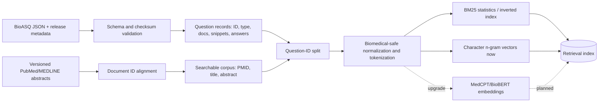

# BioRAG-Hybrid: Professor-Ready Ingestion and Retrieval Pipelines

## One-sentence project description

BioRAG-Hybrid retrieves biomedical evidence using a transparent hybrid lexical/semantic ranker, selects coherent evidence sentences with HMM/Viterbi, and produces an extractive answer that can be evaluated against BioASQ gold evidence and answers.

## Important status statement

The repository contains two different levels of evidence:

1. **Working prototype:** the complete loader → retrieval → evidence → answer → metrics path runs on `data/sample/bioasq_sample.json` (6 synthetic questions, 13 documents).
2. **Official ingestion now completed locally:** `data/official/training11b.json` contains 4,719 BioASQ11 questions; the ingestion tool fetched 40,160 aligned PubMed abstracts for 40,221 unique references. The 61 unavailable references are recorded by the corpus count/metadata.

The searchable corpus is now `data/official/pubmed_abstracts.json`, with provenance in `data/official/pubmed_abstracts.metadata.json`. Do not index the gold snippets as a substitute for article text because that would leak evaluation evidence.

---

## Pipeline 1 — Data ingestion and index construction

### Purpose

Convert raw BioASQ questions plus a searchable biomedical article corpus into validated records, clean text, train/validation/test splits, and retrieval indexes.

### Flow



### Exact implementation mapping

| Stage | What happens | Current location | Status |
|---|---|---|---|
| Acquire | Download BioASQ release and record version, date, licence, checksum | `data/README.md`; `data/official/training11b.json` | BioASQ11 JSON present |
| Inspect | Count records/types/documents/snippets; detect duplicates and embedded text | `tools/inspect_bioasq.py` | Implemented and run |
| Load | Parse common BioASQ wrappers; preserve IDs, document refs, snippets, exact/ideal answers | `src/biorag/data.py` | Implemented |
| Normalize | Whitespace, biomedical punctuation, tokenization, sentence splitting | `src/biorag/text.py` | Implemented |
| Acquire article text | Resolve document references to stable PMID/title/abstract records | `tools/build_official_corpus.py` | Implemented; 40,160 abstracts fetched |
| Split | Split by question ID before fitting statistics or tuning thresholds | `data/official/question_split.json` | Implemented: 3,712/506/501 |
| Build lexical index | BM25 with `k1=1.5`, `b=0.75` | `src/biorag/retrieval.py` | Implemented in memory |
| Build semantic signal | Character 3-gram cosine proxy | `src/biorag/retrieval.py` | Implemented proxy, not a learned encoder |
| Persist artifacts | Save corpus metadata, split manifest, index/vector files, config | Not yet implemented | Recommended next step |

### Ingestion record contract

Each question record should retain:

```text
question_id
question_body
question_type: factoid | list | yesno | summary
candidate_document_ids
gold_document_ids / gold_snippets
exact_answer, when available
ideal_answer
split: train | validation | test
```

Each corpus document should retain:

```text
stable_document_id / PMID
title
abstract_or_full_text
source, release_version, retrieval_date, checksum
```

### Ingestion validation gates

Before retrieval is allowed, check:

- JSON schema and required question body are valid.
- Question IDs are unique; official inspection currently reports 0 duplicates.
- Question-type counts and missing-answer counts are logged.
- Every gold document reference is either aligned to the corpus or explicitly marked missing.
- Article text is not empty for indexed documents.
- Train/validation/test question IDs are disjoint.
- BM25 and semantic statistics are fitted only on the permitted training/index corpus.
- Gold snippets and ideal answers are never inserted into the searchable article text.
- The source version, checksum, and configuration are saved with every experiment.

### Current ingestion evidence

Run:

```bash
PYTHONPATH=src python3 tools/inspect_bioasq.py \
  data/official/training11b.json \
  --output artifacts/results/bioasq11_inspection.json
```

Observed locally: 4,719 records; factoid 1,417; list 901; summary 1,130; yes/no 1,271; 42,608 document references; 56,795 snippets; 0 embedded article texts; 0 duplicate question IDs.

---

## Pipeline 2 — Query retrieval, evidence selection, and answer evaluation

### Purpose

Given a biomedical question and a prepared corpus, retrieve relevant documents, select supporting sentences, generate a safe extractive answer, and measure performance.

### Flow

```mermaid
flowchart LR
  Q[Question + type] --> N[Normalize and tokenize]
  N --> B[BM25 score]
  N --> S[Semantic score: n-gram proxy now / biomedical encoder later]
  B --> F[Min-max normalize + weighted fusion]
  S --> F
  F --> R[Top-k documents]
  R --> T[Sentence segmentation]
  T --> H[Question-sentence overlap emissions]
  H --> V[3-state HMM + log-space Viterbi]
  V --> E[SUPPORT / CONTEXT / NOISE]
  E --> X[Verbatim extractive answer]
  X --> O[Answer + cited document/sentence IDs]
  O --> M[Recall@k, MRR, snippet recall, EM/F1, ROUGE-L]
  M --> A[Error analysis: unsupported, negation, conflict, missing evidence]
```

### Exact implementation mapping

| Stage | Algorithm/output | Current location | Status |
|---|---|---|---|
| Query preparation | Normalize and tokenize question | `src/biorag/text.py` | Implemented |
| Lexical retrieval | BM25 document score | `src/biorag/retrieval.py` | Implemented |
| Semantic retrieval | Character n-gram cosine proxy | `src/biorag/retrieval.py` | Implemented proxy |
| Fusion | `0.60 × lexical + 0.40 × semantic` after min-max normalization | `config/prototype.json`; `retrieval.py` | Implemented |
| Top-k | Ranked documents, default `k=3` | `run_pipeline.py` | Implemented |
| Sentence processing | Sentence segmentation | `src/biorag/text.py` | Implemented |
| Evidence selection | Fixed HMM states `SUPPORT`, `CONTEXT`, `NOISE`; Viterbi decoding | `src/biorag/hmm.py` | Implemented prototype |
| Answering | Verbatim extractive evidence, max 2 sentences | `src/biorag/run_pipeline.py` | Implemented |
| Neural generation | RNN/GRU summary generation | Planned in config/docs | Not implemented |
| Evaluation | Recall@k, MRR, token F1, ROUGE-L helpers | `src/biorag/metrics.py` | Implemented sanity metrics |

### Retrieval equations to show

For document `d` and query `q`:

```text
lexical(d,q) = BM25(q,d),       k1=1.5, b=0.75
semantic(d,q) = cosine(char-3-gram(q), char-3-gram(d))
hybrid(d,q) = 0.60 * minmax(lexical) + 0.40 * minmax(semantic)
```

The current semantic branch is explicitly a **subword similarity proxy**. It is not BioBERT, MedCPT, CBOW, Skip-gram, or a claim of synonym/entailment understanding. The planned upgrade replaces this branch with a licensed biomedical encoder and compares it through an ablation.

### Retrieval validation plan

Run the following controlled baselines on the same split and corpus:

| Experiment | Retriever | Evidence selector | Why |
|---|---|---|---|
| B0 | BM25 only | Top-overlap sentence | Lexical baseline |
| B1 | BM25 only | HMM/Viterbi | Measures value of sequence selection |
| B2 | Biomedical dense encoder | Top score | Semantic baseline |
| B3 | BM25 + dense encoder fusion | HMM/Viterbi | Main hybrid system |
| B4 | Main hybrid + reranking | HMM/Viterbi | Optional final extension |

Report overall and per question type:

- Document retrieval: Recall@1/@3/@5 and MRR.
- Evidence: gold-snippet recall, sentence precision, supported-evidence rate.
- Factoid/list/yes-no: exact match, token F1, and yes/no macro-F1.
- Summary: ROUGE-L plus manual factual-support review.
- Reliability: unsupported-claim count, negation errors, contradictory-evidence errors, and no-evidence rate.

Do not report the six-record fixture metrics as BioASQ performance.

---

## What is implemented versus what must be completed

### Implemented now

- BioASQ-shaped loader and answer flattening.
- Text normalization, tokenization, and sentence splitting.
- BM25 retrieval.
- Inspectable character n-gram similarity proxy.
- Weighted hybrid fusion.
- HMM/Viterbi evidence selection.
- Extractive answer output with source document IDs.
- Retrieval and summary sanity metrics.
- 11 unit tests and an end-to-end smoke run.

### Remaining work for a full official experiment

1. Persist a faster production index rather than rebuilding the in-memory BM25 structure for every run.
2. Run BM25-only, semantic-only, and hybrid ablations on the saved official split.
3. Add official question-type-specific scoring and gold-snippet/evidence evaluation.
4. Perform manual support, negation, and conflict review.
5. Only then train the planned RNN/GRU summarizer, if time and hardware permit.

## Commands for tomorrow's demonstration

```bash
# 1. Validate the official BioASQ question/evidence file
PYTHONPATH=src python3 tools/inspect_bioasq.py \
  data/official/training11b.json \
  --output artifacts/results/bioasq11_inspection.json

# 2. Run the complete implemented prototype on the included fixture
PYTHONPATH=src python3 -m biorag.run_pipeline \
  --data data/sample/bioasq_sample.json \
  --output artifacts/results/demo_results.json

# 3. Run automated checks
PYTHONPATH=src python3 -m unittest discover -s tests -v

# Official-data smoke run (20 questions; full corpus)
PYTHONPATH=src python3 -m biorag.run_pipeline \
  --data /path/to/official_subset.json \
  --corpus data/official/pubmed_abstracts.json \
  --output artifacts/results/official_subset_results.json
```

Expected current evidence: 11 tests pass; the smoke run processes 6 questions and 13 documents; fixture Recall@3 and MRR are both 1.0. These are execution checks only, not official BioASQ results.

## Thirty-second explanation to the professor

“Our system has two separable pipelines. The ingestion pipeline validates BioASQ questions, aligns their document references to a separate searchable biomedical corpus, normalizes the text, splits by question ID, and builds BM25 plus semantic indexes. The retrieval pipeline takes a question, fuses lexical and semantic scores, selects top documents, applies a three-state HMM/Viterbi model to their sentences, and returns a verbatim evidence-supported answer with document citations. The current repository proves the full algorithmic path on a synthetic fixture and validates the official BioASQ release metadata; the remaining experimental dependency is the aligned article-text corpus needed to report non-leaky official retrieval results.”
