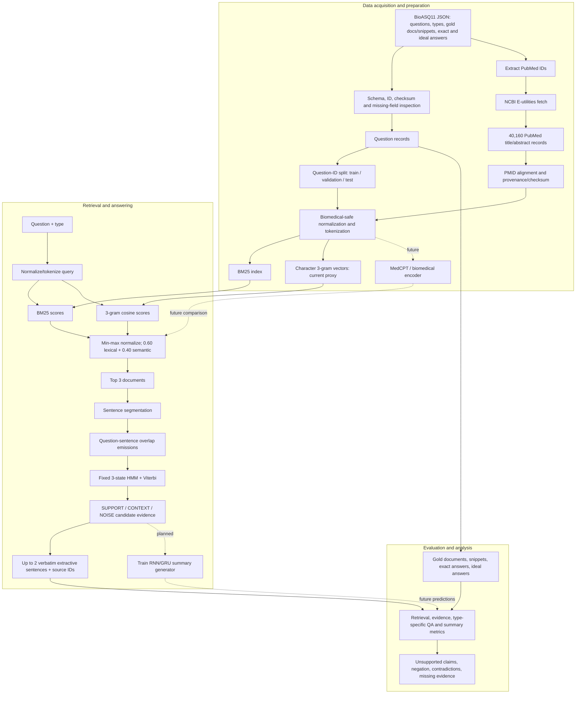

# BioRAG-Hybrid: complete project status and study guide

**Snapshot:** repository evidence inspected 13 October 2026. This report separates implementation, observed execution, and research still required. It is a project status report, not a claim of clinical validity.

## Executive summary

BioRAG-Hybrid explores biomedical question answering with hybrid retrieval, explicit sentence evidence selection, and supported answers. The repository has a working Python prototype and now includes the BioASQ11 question set plus a PubMed abstract corpus aligned to its document references. The prototype implements BM25 + character 3-gram similarity, weighted fusion, a fixed three-state HMM/Viterbi selector, verbatim extractive output, and basic metrics.

The most directly relevant **methodological base paper** is Xiong et al. (2024), *Benchmarking Retrieval-Augmented Generation for Medicine* (MIRAGE/MedRAG): it motivates comparing corpora, lexical/dense retrievers, and rank fusion. The **benchmark/data base** is Krithara et al. (2023), *BioASQ-QA*, which defines the question types, evidence labels, exact answers, and ideal answers used here. Sohn et al. (2025), RAG², is a secondary reliability/evidence-filtering comparator, not the direct implementation blueprint.

There are official-data execution artifacts, but the aggregate metrics saved with them are **exploratory, not a clean held-out benchmark result**: the implementation evaluates all 4,719 questions together, does not apply the saved train/validation/test manifest, and uses fixed parameters. In addition, the implemented recall metric compares ranked documents with the full gold document set, and summary metrics are computed across all question types (including cases without ideal-answer-style summaries). Report these figures only as an end-to-end exploratory run until a split-aware, type-aware evaluation is implemented.

## What is done

| Area | Implemented/evidence | Status and boundary |
|---|---|---|
| Project specification | Research question, architecture, evaluation plan, presentations/diagrams | Done; RNN is explicitly future work |
| BioASQ loader | JSON parsing, IDs, types, references, snippets, exact/ideal answers | Implemented |
| BioASQ11 inspection | 4,719 records; 0 duplicate IDs; 42,608 document references; 56,795 snippets; 0 embedded article texts | Done; local checksum recorded |
| Searchable text corpus | NCBI PubMed E-utilities tool; 40,160 abstracts from 40,221 requested unique references; 61 not returned | Corpus acquired; source/checksum metadata saved |
| Question split manifest | Seed 17, 3,712 train / 506 validation / 501 test | Created, but current runner does not consume it |
| Preprocessing | biomedical-safe normalization/tokenization/sentence splitting | Implemented |
| Retrieval | BM25 (`k1=1.5`, `b=0.75`), character 3-gram cosine proxy; min-max score scaling; 0.60 lexical + 0.40 semantic; top 3 | Implemented; n-gram proxy is not a biomedical encoder or trained CBOW/Skip-gram |
| Evidence | Fixed `SUPPORT`, `CONTEXT`, `NOISE` HMM with log-space Viterbi | Implemented prototype; overlap-based state is not entailment verification |
| Answer | Up to two verbatim selected sentences; source document IDs | Implemented; `short_answer` remains null |
| Metrics | Recall@3, MRR@3, token F1, ROUGE-L | Implemented helpers; current official aggregates need correct split/type-aware protocol |
| Tests | 11 unit tests documented as passing in prior recorded run | Existing evidence; not rerun for this report |
| Neural generation/reranking | RNN/GRU, MedCPT/BioBERT, cross-encoder | Not implemented |

## Results currently recorded

| Run | Questions / corpus | Recall@3 | MRR@3 | Summary token F1 | ROUGE-L F1 | Interpretation |
|---|---:|---:|---:|---:|---:|---|
| Synthetic fixture (`demo_results.json`) | 6 / 13 | 1.000000 | 1.000000 | 0.443306 | 0.429417 | Smoke fixture only; not BioASQ performance |
| Official smoke (`official_smoke_results.json`) | 20 / 40,160 | 0.293591 | 0.950000 | 0.246352 | 0.180096 | Exploratory subset; not held-out or official score |
| Saved full-data notebook result (`official_notebook_results.json`) | 4,719 / 40,160 | 0.436163 | 0.855725 | 0.251309 | 0.198357 | Exploratory all-record aggregate; do not present as held-out benchmark |

MRR can be high alongside lower recall because MRR gives credit for the rank of the first relevant item, while recall measures coverage of all known relevant documents. The current run also returns extracted evidence without scoring factoid/list/yes-no answers as those task types require. Use numbers only with the caveats above.

## Papers: what each contributes

### 1. Direct methodological base: MIRAGE / MedRAG

**Xiong, Jin, Lu & Zhang (2024), “Benchmarking Retrieval-Augmented Generation for Medicine,” Findings of ACL 2024.** DOI: [10.18653/v1/2024.findings-acl.372](https://doi.org/10.18653/v1/2024.findings-acl.372). It introduces MIRAGE (7,663 multiple-choice questions from MMLU-Med, MedQA-US, MedMCQA, PubMedQA*, and BioASQ-Y/N) and the MedRAG toolkit. It compares PubMed, StatPearls, textbooks, Wikipedia, and combined MedCorp, with BM25, Contriever, SPECTER, MedCPT and reciprocal-rank fusion, across six LLMs. Main outcome: retrieval/corpus choice matters; MedRAG improves six LLMs over chain-of-thought baselines by 1–18%; e.g. GPT-3.5 averages 71.57 with MedCorp + RRF-4 versus 60.69 without retrieval. Limitations for our purpose: costly scale, primarily multiple-choice accuracy, vanilla RAG, and limited gold retrieval labels.

**What to study/adapt:** BM25 vs semantic vs fused retrieval, a lexical-only baseline, fixed corpora and top-k comparisons, separate retrieval and QA metrics. Do not imply this project reproduces MedRAG scale or results. Our proposed difference is transparent HMM sentence selection and support-oriented summary analysis.

### 2. Reliability comparator: RAG²

**Sohn et al. (2025), “Rationale-Guided Retrieval Augmented Generation for Medical Question Answering,” NAACL 2025.** DOI: [10.18653/v1/2025.naacl-long.635](https://doi.org/10.18653/v1/2025.naacl-long.635). RAG² generates rationale queries, retrieves across balanced corpora, reranks with MedCPT, and filters snippets with a learned Flan-T5 filter. It reports 66.3 average on Llama-3-8B-Instruct over MedQA/MedMCQA/MMLU-Med versus 60.7 for MedRAG. It emphasizes irrelevant context, corpus bias, and evidence filtering. Its retrieval corpus and training footprint are far beyond the current CPU prototype; it is mainly a comparator for reliability ideas rather than a direct reproduction target.

**What to study/adapt:** failure cases, filter/selector ablations, corpus balance, and evidence utility. Later compare HMM with top-overlap and a learned filter if resources allow.

### 3. Benchmark and dataset foundation: BioASQ-QA

**Krithara et al. (2023), “BioASQ-QA: A manually curated corpus for Biomedical Question Answering,” Scientific Data.** DOI: [10.1038/s41597-023-02068-4](https://doi.org/10.1038/s41597-023-02068-4). BioASQ Task B supplies English biomedical questions in four types—yes/no, factoid, list, summary—alongside relevant article references, snippets, exact answers where applicable, and ideal paragraph answers. Its release is evolving; the paper’s 4,721 count is publication-time metadata, while this local BioASQ11 file has 4,719. Expert annotations enable retrieval and answer evaluation, but relevant-document/snippet judgments can vary among experts; ideal answers tend to be more consistent.

**What to study/adapt:** JSON schema, question-type-specific scoring, evidence labels, annotation agreement, and benchmark split/version tracking. This paper defines the project’s data and task, but does not prescribe the hybrid/HMM method.

## Datasets and benchmark contract

### BioASQ11 local question/evidence file

- `data/official/training11b.json`; SHA-256 `6df656862ca860efc355c7805d07ddca700d64ecc3785c519a49afccaaeeac98`.
- 4,719 question records: factoid 1,417; list 901; summary 1,130; yes/no 1,271.
- 42,608 article references and 56,795 snippets; every record has document refs, snippets, and ideal answer; 3,589 have nonempty exact-answer fields.
- No abstract/article body is embedded. The references are PubMed URLs; they are relevance labels, not the corpus text.
- Zenodo record metadata is documented as open access, CC BY 2.5. Keep attribution, version, retrieval date, and checksums with any redistributed results.

### Aligned PubMed abstract corpus

- `data/official/pubmed_abstracts.json`, source NCBI PubMed E-utilities; metadata at `data/official/pubmed_abstracts.metadata.json`.
- 40,221 unique PMID references requested, 40,160 articles with title and/or abstract retrieved, 61 unavailable. Corpus SHA-256: `ec08b2c85da78c94d06a0b01b21b50c2d7d4ddce231edc7811b3062cc0a8cdb6`.
- Gold snippets are explicitly not indexed as corpus text. This avoids the most direct evidence leakage path.
- Split manifest `data/official/question_split.json`: seed 17; 80/10/10 by question ID (3,712 / 506 / 501). It must actually be applied in evaluation before calling a result held-out.

### Benchmark metrics to implement/report by task

| Stage/task | Metrics |
|---|---|
| Document retrieval | Recall@1/@3/@5, MRR; clearly define whether relevance is any gold article or full-set coverage |
| Snippet/sentence evidence | Gold-snippet recall, sentence precision, supported-evidence rate; manual review protocol |
| Factoid | Exact match and token F1 with accepted answer variants |
| List | Precision/recall/F1 over answer items; normalize order/aliases consistently |
| Yes/no | Accuracy and macro-F1; explicitly score polarity and qualification |
| Summary | ROUGE-L plus expert/manual claim support and contradiction review |
| Reliability | Unsupported-claim rate, negation flips, contradiction errors, no-evidence rate |

Do not collapse these into a single score without stating aggregation and question-type coverage. ROUGE/F1 computed against ideal answers on every record is not a substitute for official task-specific scoring.

## Full data flow

## What to study next

1. Read the BioASQ-QA paper first to understand labels, question types, and annotation limitations.
2. Read MIRAGE/MedRAG next for the experiment design: corpus × retriever × fusion comparisons, baselines, and top-k effects.
3. Read RAG² for reliability, filtering and error-analysis concepts; focus on its method and failure analysis rather than reproducing its expensive training.
4. Review BM25, reciprocal-rank fusion, cosine similarity, HMM emissions/transitions and Viterbi decoding. Be ready to explain that the current “semantic” component is character n-gram overlap/distribution, not a trained biomedical language model.
5. Learn BioASQ’s official per-type answer scoring and agree on the supported-claim annotation guide before adding generation.

## Future work in priority order

### P0 — Make official evaluation defensible

- Modify runner/notebook to consume the saved question split; keep validation for parameter selection and evaluate once on held-out test.
- Fix retrieval corpus construction and metrics so each query is ranked against the same defined corpus and report recall semantics clearly.
- Implement question-type-specific answer scoring; compute summary metrics only for summary questions; add gold snippet evaluation.
- Save config, split, corpus/question checksums, software versions, per-question outputs, and aggregate results together.
- Run BM25-only, n-gram-only, fused, and fusion-weight/top-k ablations; compare HMM to top-overlap selection.

### P1 — Evidence quality and biomedical semantics

- Manually label a stratified sample for support, contradiction, negation, and answer completeness; report reviewer guidance and agreement.
- Add an actual biomedical dense retriever (e.g. MedCPT) after licensing/hardware review; compare against the proxy and lexical baseline.
- Measure missing-PMID impact and corpus-date effects; use a fixed corpus snapshot.

### P2 — Generation and system polish

- Add a trained RNN/GRU only after evidence selection is stable; define train targets and prevent ideal-answer leakage across split.
- Compare extractive output, trained generator, and optionally a reranker/filter; include factual support checks.
- Persist/reuse indexes for speed, improve CLI experiment logging, and produce final report/presentation with held-out results.

## Files to inspect

- Research: `docs/02_literature_review.md`, `docs/03_dataset_methodology.md`, `docs/research_sources.md`
- Implementation: `src/biorag/{data,text,retrieval,hmm,metrics,run_pipeline}.py`
- Data build and inspection: `tools/inspect_bioasq.py`, `tools/build_official_corpus.py`, `data/README.md`
- Outputs: `artifacts/results/official_notebook_results.json`, `official_smoke_results.json`, `demo_results.json`
- Diagrams: `artifacts/diagrams/technical_architecture.mmd`, `simple_workflow.mmd`
- Milestones and verification: `docs/08_milestone_checklist.md`, `docs/09_final_verification.md`, `docs/10_professor_ready_pipelines.md`
